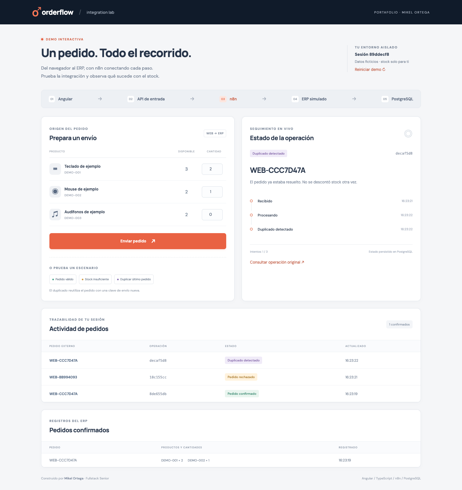
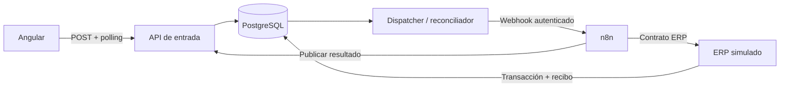

# Orderflow · integración de pedidos con n8n

Demo de portafolio de **Mikel Ortega**, Ingeniero en Sistemas y Fullstack Senior. Una pantalla Angular envía pedidos ficticios a una integración asíncrona con **n8n, Node.js/TypeScript y PostgreSQL**. El ERP es simulado; las transacciones, el stock, los estados y la recuperación son reales.



## Qué demuestra

- Orquestación n8n con transformación de contratos, ramas de resultado y workflow de errores.
- Diferencia entre reenviar una solicitud con la misma clave y duplicar un pedido con una clave nueva.
- Stock y pedido en una transacción; bloqueos y recibos persistentes para evitar sobreventa y efectos repetidos.
- Recuperación si el ERP confirma un pedido pero se pierde su respuesta.
- Sesiones anónimas con stock privado, polling y estados persistidos.

**Estado:** MVP local implementado y código publicado en [GitHub](https://github.com/Mikel26/order-integration-n8n-demo). La live demo aún no tiene una URL pública. No se atribuyen clientes, uso productivo o métricas comerciales. Consulta las ejecuciones y resultados del pipeline en [GitHub Actions](https://github.com/Mikel26/order-integration-n8n-demo/actions/workflows/ci.yml).

[Video de demostración](docs/demo.webm) · [Captura móvil](docs/screenshots/demo-mobile.png) · [Arquitectura](docs/architecture.md) · [Workflows](docs/workflow.md) · [Especificación original](docs/ESPECIFICACION.md)

## Ejecutar localmente

Requisitos: Docker con Compose v2 y Node.js **24.12.0** (ver `.nvmrc`). Puertos locales libres: `4200`, `3000`, `5433` y `5678`. La primera construcción descarga imágenes y dependencias.

```sh
nvm use
npm ci
npm run setup:env
docker compose up -d --build --wait
```

Abrir [la demo local](http://localhost:4200). `setup:env` genera secretos aleatorios en `.env`, con permisos restringidos, y conserva el archivo si ya existe. No requiere cuentas ni credenciales de un ERP real.

Compose aplica migraciones e importa credenciales y ambos workflows en n8n automáticamente. La importación usa la CLI dentro de la red local. Al completar, guarda un marcador en el volumen de n8n y no sobrescribe ediciones posteriores. El [runbook](docs/runbook.md) explica cómo reimportar deliberadamente.

El [editor n8n local](http://localhost:5678) solo está ligado a localhost. Si lo abres por primera vez, completa su configuración de propietario con una cuenta local; la integración mediante webhook ya funciona sin abrir el editor. No publiques el editor sin configurar su acceso.

## Probar en un minuto

En una sesión nueva:

1. **Pedido válido:** dos teclados y un mouse. El resultado es `SUCCEEDED`; stock `3 / 2 / 2`.
2. **Stock insuficiente:** tres audífonos cuando quedan dos. Resultado `REJECTED`; stock sin cambios.
3. **Duplicar último pedido:** mismo pedido y contenido, nueva clave. Resultado `DUPLICATE`; sigue existiendo un solo pedido confirmado.

El formulario permite cantidades de 0 a 10; solo se envían líneas con cantidad positiva. Los escenarios envían solicitudes reales, sin resultados precalculados. Al agotar existencias, reinicia la demo para repetir el escenario válido. El reinicio crea otra sesión; las operaciones anteriores no modifican su stock.

## Arquitectura



La API admite una operación antes de invocar n8n. El worker entrega y reconcilia; **no crea pedidos directamente en el ERP**. n8n reclama el intento, transforma líneas, llama al ERP y dirige las ramas de negocio/técnicas. El ERP mantiene atomicidad y deduplicación. La API y el ERP comparten la base del dominio para resolver carreras bajo los mismos bloqueos; n8n tiene otra base y otro usuario.

## Verificaciones

Con el entorno Compose activo:

```sh
npm run format:check
npm run typecheck
npm test
npm run test:integration
npm run test:smoke
npm run test:recovery
npx playwright install chromium
npm run test:e2e
```

`test:integration` exige `TEST_DATABASE_URL` con nombre terminado en `_test` y vacía **solo esa base**. `test:smoke` usa la demo local y verifica A/B/C a través de n8n. `test:recovery` detiene temporalmente **solo `mock-erp`**, comprueba una ejecución real del error handler y vuelve a arrancarlo en `finally`. Ejecutar estas pruebas de forma secuencial, en un entorno local sin usuarios.

Las E2E abren navegadores de pruebas aislados y generan capturas. Si ya tienes Chrome instalado puedes usar `PLAYWRIGHT_CHANNEL=chrome npm run test:e2e`; para grabar videos también debe estar instalado `npx playwright install ffmpeg`. Las cuotas de creación de sesiones se aplican en las pruebas en vivo; no ejecutarlas repetidamente contra una demo compartida. Ver [resultados y límites](docs/VALIDACION.md).

## Desarrollo con recarga

Arranca primero la infraestructura con Compose. Para trabajar con las APIs en el host:

```sh
docker compose stop ingress-api dispatcher mock-erp web
npm run dev:api
# En otra terminal:
npm run dev:erp
# Y en otra terminal, tras configurar los destinos internos de n8n:
npm run dev:worker
```

El webhook de n8n usa nombres internos de Docker. Para desarrollar las APIs fuera de Docker, cambia temporalmente en una copia local de los workflows los destinos a `host.docker.internal:3001/3002`, reimpórtalos y revierte antes de publicar. La ruta más sencilla para cambios de backend es `docker compose up -d --build`.

Para modificar solo Angular, conserva las APIs en Docker y ejecuta:

```sh
docker compose stop web
npm run dev:web
```

El proxy Angular apunta a `localhost:3000`. Las credenciales de integración permanecen en el servidor. `npm run build` compila servidor y frontend; Docker también ejecuta las compilaciones.

## Estructura y avances

```text
apps/ingress-api/     API pública/interna y worker
apps/mock-erp/        API ERP simulada
apps/web/            Pantalla Angular
packages/contracts/  Contratos compartidos y esquemas de entrada
packages/core/       Configuración, persistencia y reglas de integridad
database/            Inicialización y migraciones
workflows/           JSON sanitizados, importables en n8n
scripts/             Preparación, migración, pruebas reales y grabación
tests/               Unitarias, PostgreSQL real y E2E
docs/                Decisiones, operación, evidencia y especificación
```

El historial se organiza en fases: contratos → ERP/persistencia → n8n/recuperación → Angular → entrega y CI. [Progreso detallado](docs/PROGRESO.md).

## Límites de esta demo

Sesiones de 30 minutos; retención de resultados 24 horas tras cerrar; máximo tres intentos y plazo de operación de 120 segundos mientras los servicios estén disponibles. Cuotas por sesión/IP y capacidades globales están en `Domain` y su configuración. La UI no convierte un timeout en un rechazo de negocio. No se promete entrega exactamente una vez: las transacciones y los recibos evitan efectos repetidos.

Compose está diseñado para desarrollo local. Antes de publicar: elegir infraestructura/presupuesto, configurar HTTPS y cookies seguras, fijar el origen público, configurar el proxy confiable y sus límites, restringir los puertos de infraestructura y revisar condiciones de uso de n8n. No se promete hosting gratuito. Sin un proxy confiable configurado, las cuotas por IP detrás de Nginx se agregan por la IP de ese proxy; es conservador, pero limita a varios visitantes como grupo.

No incluye pagos, carrito, catálogo administrativo, IA, Kubernetes ni integración con un ERP comercial.
