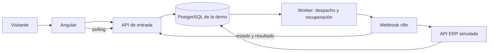

# Demo pública de integración de pedidos con n8n

**Autor:** Mikel Ortega · **Fecha:** 29 de octubre de 2026 · **Estado:** especificación lista para implementar.

Este documento define el proyecto; no contiene una aplicación implementada ni servicios desplegados. Nombre provisional para GitHub: `order-integration-n8n-demo`.

## 1. Propósito y resultado esperado

**Objetivo profesional.** Mostrar a reclutadores cómo un Ingeniero en Sistemas y Fullstack Senior integra una interfaz Angular con servicios Node.js/TypeScript, PostgreSQL y automatizaciones n8n. Aprovecha las fortalezas de Mikel en Angular/Ionic, TypeScript, Node.js, .NET y SQL Server y amplía su evidencia práctica con n8n y PostgreSQL. No pretende acreditar experiencia de producción que aún no existe.

**Objetivo de negocio simulado.** Recibir pedidos de un canal externo, traducirlos al contrato de un ERP y registrarlos sin sobreventa ni descuentos duplicados. Un operador debe distinguir un rechazo por stock de un fallo de comunicación y conocer el resultado final aunque se pierda una respuesta.

**Experiencia de evaluación.** En una sola pantalla, el visitante envía un pedido ficticio, observa estados reales y comprueba pedidos y existencias de su sesión. GitHub explica las decisiones, una captura muestra el workflow y un video de 60–90 segundos permite revisar el caso cuando los servicios estén suspendidos. Objetivo de comprensión: dos o tres minutos, sin registro.

## 2. Alcance del MVP

- Una pantalla Angular con tres productos fijos, cantidades enteras, botón **Enviar pedido** y acciones **Pedido válido**, **Stock insuficiente** y **Duplicar último pedido confirmado**.
- API de entrada asíncrona, seguimiento por polling, aislamiento por sesión y tablas de pedidos/stock.
- Workflow principal n8n y workflow de errores; transformación explícita entre contratos, clasificación del resultado y recuperación acotada.
- ERP simulado con transacción real, deduplicación persistente, pruebas de concurrencia y fallos de comunicación.
- Ejecución local reproducible, repositorio público sin secretos y alternativa audiovisual.

**Exclusiones:** e-commerce completo, carrito persistente, pagos, usuarios comerciales, correos a terceros, catálogo administrativo, ERP real, Ionic móvil, .NET adicional, SQL Server adicional, agentes IA, Kubernetes, Redis y alta disponibilidad. La simulación no calcula impuestos, precios ni facturas: el valor demostrado está en la integración.

## 3. Stack y límites de arquitectura

| Componente | Elección y responsabilidad |
|---|---|
| Frontend | Angular estable, TypeScript, formularios reactivos, HttpClient y RxJS; una ruta principal |
| API de entrada | Node.js LTS + TypeScript + Fastify; validación JSON Schema, sesiones, operaciones, consultas y límites |
| Orquestador | n8n autoalojado en modo regular; dos workflows, credenciales de servidor |
| ERP simulado | Otro servicio del mismo monorepo Node.js/TypeScript + Fastify; dominio de pedidos y transacciones PostgreSQL |
| Persistencia | PostgreSQL; SQL parametrizado con `pg`, migraciones versionadas y pool pequeño por proceso |
| Despacho y recuperación | Proceso worker del paquete API; lee operaciones pendientes de PostgreSQL, entrega a n8n y reconcilia |
| Ejecución | Docker Compose con imágenes fijadas a versiones probadas, lockfile y health checks |
| Pruebas | Vitest para lógica y API, PostgreSQL real en integración y Playwright para el recorrido principal |

Elegir las versiones exactas al implementar y anotarlas en README; evitar etiquetas `latest`. No se requiere contratar un proveedor específico.



El worker es infraestructura de entrega, no replica el workflow. n8n reclama la ejecución, transforma `items` a `lines`, llama al ERP, distingue éxito/rechazo/duplicado, solicita la publicación del resultado y clasifica fallos técnicos. Sin n8n no se procesan nuevos pedidos; quedan pendientes y terminan con un fallo visible al agotarse el presupuesto. El ERP conserva las reglas y la atomicidad: n8n no ejecuta descuentos mediante varios nodos SQL.

La API y el ERP comparten deliberadamente la base de la demo para bloquear operaciones y resolver carreras en una sola transacción. Es una simplificación documentada, no una promesa de microservicios independientes. n8n usa una base propia para su configuración y ejecuciones, con usuario distinto; no consulta directamente las tablas de negocio.

## 4. Sesiones y datos de ejemplo

`POST /api/demo-sessions` crea un UUID aleatorio, una cookie opaca y existencias privadas:

| SKU | Producto sintético | Stock inicial por sesión |
|---|---|---:|
| DEMO-001 | Teclado de ejemplo | 5 |
| DEMO-002 | Mouse de ejemplo | 3 |
| DEMO-003 | Audífonos de ejemplo | 2 |

El servidor deriva `sessionId` de la cookie; ningún endpoint público acepta elegir el propietario mediante el cuerpo. Dos visitantes pueden usar el mismo SKU o `clientOrderId` y tienen existencias independientes. Las pestañas del mismo navegador comparten sesión y sí compiten por el mismo stock. No se recopilan nombres, correos ni direcciones.

Valores iniciales de diseño, configurables: sesión válida 30 minutos; estado `ACTIVE → CLOSING → EXPIRED`; limpieza cada minuto y retención de resultados 24 horas tras cerrar. No son límites del producto n8n ni compromisos de disponibilidad.

**Cierre y reinicio sin carreras:** todas las transacciones mutantes toman primero el bloqueo de la fila de sesión y después el de operación. Al vencer, el limpiador bloquea la sesión y la marca `CLOSING`; la admisión deja de aceptar pedidos. Las operaciones admitidas antes pueden terminar durante su presupuesto de 120 segundos. Una sesión pasa a `EXPIRED` solo cuando no quedan operaciones no terminales; después se elimina al vencer la retención. La reconciliación resuelve/frena las operaciones antiguas antes de borrar. Mientras está `CLOSING`, se permite consultar resultados.

**Reiniciar demo** cierra la sesión anterior y crea otra con stock inicial, sin modificar las filas de stock anteriores. La transición de sesión y la nueva siembra son atómicas. La UI advierte si existen operaciones anteriores y deja consultar su resultado hasta terminar. El worker nunca sustituye un `sessionId` antiguo por el nuevo. No se ejecuta un `TRUNCATE` periódico ni se repone stock de una sesión activa.

## 5. Operaciones, estados e identidad

Tres identidades distintas:

1. **`operationId`:** UUID generado por el servidor para seguir una solicitud admitida.
2. **`Idempotency-Key`:** UUID generado por Angular para un envío. Ante pérdida de respuesta, se reutilizan esta clave y exactamente el mismo cuerpo. Restricción única `(session_id, idempotency_key)`.
3. **`clientOrderId`:** identificador del pedido en el canal ficticio, máximo 64 caracteres. Dos envíos con claves distintas pero este identificador igual representan un duplicado de negocio. Restricción única del recibo ERP `(session_id, client_order_id)`.

La API calcula un SHA-256 del JSON canónico: contrato/versionado, `clientOrderId` y líneas ordenadas por SKU. No incluye la clave de idempotencia ni timestamps. Se rechazan SKU repetidos en un mismo pedido. El ERP calcula su huella equivalente usando su propio contrato normalizado; no confía en una huella enviada por el navegador.

| Estado | Significado | Terminal |
|---|---|---|
| `ACCEPTED` | Guardado en PostgreSQL, pendiente de entrega | No |
| `PROCESSING` | n8n reclamó el intento; puede estar pendiente publicar un recibo ya confirmado | No |
| `RETRY_WAIT` | Fallo técnico recuperable y próxima fecha de intento | No |
| `SUCCEEDED` | Pedido y descuento confirmados | Sí |
| `REJECTED` | Regla de negocio impide procesarlo | Sí |
| `DUPLICATE` | Mismo pedido y contenido ya resueltos en otra operación | Sí |
| `FAILED_TECHNICAL` | Presupuesto agotado o error técnico no recuperable, sin efecto ERP pendiente | Sí |

Transiciones: `ACCEPTED → PROCESSING`; `PROCESSING → RETRY_WAIT → PROCESSING`; desde procesamiento o reconciliación, a un estado terminal. Los fallos de entrega pueden llevar `ACCEPTED → RETRY_WAIT`. No se retrocede desde un terminal. La finalización repetida idéntica es un no-op; una contradictoria devuelve `409` y se registra.

Misma clave y misma huella devuelve la **misma operación**, sin nuevo evento de negocio. Misma clave y otra huella devuelve `409 IDEMPOTENCY_KEY_REUSED`, sin operación nueva. Clave nueva + pedido existente + huella igual crea una operación que termina `DUPLICATE`; distinta huella termina `REJECTED / ORDER_ID_CONFLICT`. Un duplicado de un rechazo conserva la referencia y el resultado original; nunca reevalúa stock. Un pedido corregido requiere otro `clientOrderId`. `DUPLICATE` no equivale a un segundo pedido confirmado.

## 6. Contrato público

Todas las rutas `/api` usan cookie de sesión salvo la creación inicial. JSON en UTF-8; tiempos ISO 8601 en UTC. Los ejemplos usan UUID válidos ilustrativos. `POST /api/orders` devuelve `202` solo tras confirmar la inserción duradera; no espera al ERP.

### 6.1 Enviar y seguir

```http
POST /api/orders
Content-Type: application/json
Idempotency-Key: 22222222-2222-4222-8222-222222222222
Cookie: demo_session=<valor-opaco>
```

```json
{
  "clientOrderId": "WEB-1001",
  "items": [
    {"sku": "DEMO-001", "quantity": 2},
    {"sku": "DEMO-002", "quantity": 1}
  ]
}
```

```http
HTTP/1.1 202 Accepted
Location: /api/operations/33333333-3333-4333-8333-333333333333
```

```json
{
  "operationId": "33333333-3333-4333-8333-333333333333",
  "status": "ACCEPTED",
  "statusUrl": "/api/operations/33333333-3333-4333-8333-333333333333",
  "replayed": false
}
```

Un reenvío exacto devuelve `202` si sigue pendiente, `200` si es terminal, con el mismo sobre, el estado actual y `replayed: true`. Nunca crea otra operación.

`GET /api/operations/:operationId` devuelve `200`:

```json
{
  "operationId": "33333333-3333-4333-8333-333333333333",
  "clientOrderId": "WEB-1001",
  "status": "SUCCEEDED",
  "attemptCount": 1,
  "updatedAt": "2026-10-29T15:00:01Z",
  "nextRetryAt": null,
  "result": {
    "code": "ORDER_CREATED",
    "orderId": "44444444-4444-4444-8444-444444444444",
    "originalOperationId": null,
    "originalStatus": null,
    "details": []
  },
  "events": [
    {"sequence": 1, "status": "ACCEPTED", "at": "2026-10-29T15:00:00Z"},
    {"sequence": 2, "status": "PROCESSING", "at": "2026-10-29T15:00:00Z"},
    {"sequence": 3, "status": "SUCCEEDED", "at": "2026-10-29T15:00:01Z"}
  ]
}
```

`result` es `null` mientras está pendiente. Para un fallo técnico: `code: INTEGRATION_UNAVAILABLE`, `orderId: null` y mensaje público sin stack. Las referencias originales solo se devuelven dentro de la misma sesión.

Polling cada segundo durante 10 segundos y luego cada tres, con jitter; se detiene en terminal o al cerrar la vista. Al superar 120 segundos de espera del navegador, mostrar “Seguimos comprobando el resultado” y permitir refrescar: la UI no decide el fallo. Recuperar `operationId` tras recargar mediante `sessionStorage` y/o la lista de operaciones. Respetar `429` y `Retry-After`; evitar intervalos superpuestos. Los eventos persistidos permiten mostrar pasos rápidos sin retrasos artificiales.

### 6.2 Rutas restantes y errores

| Método y ruta | Resultado |
|---|---|
| `POST /api/demo-sessions` | `201`, cookie y `{sessionId, expiresAt}`; si ya hay sesión activa, `200` y la misma sesión |
| `POST /api/demo-sessions/reset` | `201`, nueva cookie y `{sessionId, expiresAt, previousSessionId}` |
| `GET /api/stock` | `200`, `{items:[{sku,name,available}], updatedAt}` de la sesión |
| `GET /api/orders?limit=20&cursor=…` | `200`, `{items:[{orderId,clientOrderId,items,createdAt}], nextCursor}`; solo pedidos confirmados |
| `GET /api/operations?limit=20&cursor=…` | `200`, `{items:[{operationId,clientOrderId,status,updatedAt}], nextCursor}` |

Errores uniformes: `{ "error": { "code": "VALIDATION_ERROR", "message": "Revisa las cantidades", "requestId": "…" } }`. `400` JSON inválido; `422` esquema inválido; `401` sesión ausente; `410` sesión expirada; `404` recurso inexistente o de otra sesión; `409` clave reutilizada con otro cuerpo; `429` cuota; `503` imposibilidad de persistir/admitir. Un rechazo ERP se consulta como operación `REJECTED` con HTTP `200`, no como error de transporte del GET.

## 7. Contratos internos y ejecución asíncrona

Los endpoints internos no son accesibles desde el navegador. Autenticación de servicio y URLs fijas en configuración. La transacción de admisión crea operación y evento `ACCEPTED`; **la propia fila de operación es la bandeja duradera de trabajo**, evitando una llamada HTTP dentro de esa transacción.

1. Worker reclama una fila elegible con bloqueo y actualiza `attemptCount`, un `attemptToken` aleatorio y una concesión de 30 segundos. Máximo tres intentos totales de despacho por operación. El mensaje contiene identificadores, no instrucciones ejecutables.
2. Worker llama al webhook n8n de producción con Header Auth; recibe una confirmación inmediata. Ese `2xx` solo significa recepción, nunca pedido creado.
3. n8n llama a `POST /internal/operations/:id/claim` con `{attemptToken, executionId}`. El servidor valida concesión, sesión y estado, liga una sola ejecución a ese token, marca `PROCESSING` y devuelve el pedido canónico. Una segunda ejecución no recibe autorización para ejecutar el ERP.
4. n8n transforma el contrato y llama a `POST /internal/erp/order-imports`.
5. ERP valida y procesa atómicamente; devuelve un recibo persistido. n8n lo clasifica y llama a `POST /internal/operations/:id/finalize` con `{attemptToken, receiptId}`. La API carga y verifica el recibo; no acepta un `status` arbitrario del caller.
6. Angular observa el estado y refresca stock/pedidos al terminar.

Ejemplo de sobre del webhook:

```json
{
  "schemaVersion": 1,
  "operationId": "33333333-3333-4333-8333-333333333333",
  "attemptToken": "55555555-5555-4555-8555-555555555555"
}
```

Ejemplo del contrato ERP producido por n8n, conservando cantidades numéricas:

```json
{
  "schemaVersion": 1,
  "operationId": "33333333-3333-4333-8333-333333333333",
  "attemptToken": "55555555-5555-4555-8555-555555555555",
  "externalOrderId": "WEB-1001",
  "source": "PORTFOLIO_WEB",
  "lines": [
    {"productCode": "DEMO-001", "units": 2},
    {"productCode": "DEMO-002", "units": 1}
  ]
}
```

El ERP deriva la sesión de la operación y verifica que líneas/identificador coinciden con el pedido canónico. Primer procesamiento responde `201`, reproducción del recibo de la misma operación `200`; los resultados de negocio, incluidos rechazo y duplicado, son cuerpos válidos `200/201`:

```json
{
  "receiptId": "66666666-6666-4666-8666-666666666666",
  "operationId": "33333333-3333-4333-8333-333333333333",
  "outcome": "SUCCEEDED",
  "code": "ORDER_CREATED",
  "orderId": "44444444-4444-4444-8444-444444444444",
  "originalOperationId": null,
  "originalStatus": null,
  "details": []
}
```

`GET /internal/erp/order-imports/by-operation/:id` consulta el recibo para reconciliar; `404` significa aún no registrado, no prueba por sí solo que nunca vaya a registrarse. `POST /internal/operations/:id/report-failure` recibe `{attemptToken, code, retryable, executionId}` y pide recuperación; la API valida el contexto y decide sin contradecir recibos. `GET /internal/operations/by-execution/:executionId` permite al error handler resolver el identificador cuando el contexto del nodo fallido no lo contiene. Un evento sin correlación se registra para revisión; el worker sigue siendo la red de seguridad.

## 8. Persistencia, atomicidad y concurrencia

Modelo lógico; las migraciones SQL son un entregable futuro. UUID para identificadores públicos, `timestamptz` para fechas, `integer` para cantidades, `jsonb` solo para contratos/resultados/eventos. Estados mediante `text` con `CHECK`.

| Tabla | Campos y restricciones esenciales |
|---|---|
| `demo_sessions` | `id PK`, `token_hash UNIQUE`, `status`, `expires_at`, `closed_at`, `purge_after` |
| `products` | `sku PK`, `name`; tres filas sintéticas compartidas e inmutables |
| `session_stock` | `session_id`, `sku`, `available CHECK >= 0`; PK compuesta; FK sesión/producto |
| `operations` | `id PK`, `session_id`, `idempotency_key`, `client_order_id`, `payload_hash`, `request_json`, `status`, `attempt_count CHECK 0..3`, `attempt_token`, `execution_id`, `lease_until`, `next_attempt_at`, `deadline_at`, `result_json`, fechas; UNIQUE sesión/clave |
| `operation_events` | `operation_id`, `sequence`, `status`, `code`, `at`; PK operación/secuencia; inserción junto con cada transición |
| `business_receipts` | `id PK`, `session_id`, `client_order_id`, `payload_hash`, `original_operation_id`, `outcome` (`SUCCEEDED/REJECTED`), `code`, `order_id NULL`, `details_json`; UNIQUE sesión/pedido |
| `erp_receipts` | `id PK`, `session_id`, `operation_id UNIQUE`, `outcome`, `code`, `order_id NULL`, `original_operation_id NULL`, `original_status NULL`, `details_json`; incluye resultados `DUPLICATE` y conflicto |
| `orders` | `id PK`, `session_id`, `client_order_id`, `operation_id`, `created_at`; UNIQUE sesión/pedido y operación |
| `order_items` | `session_id`, `order_id`, `sku`, `quantity CHECK > 0`; PK pedido/SKU |

Incluir claves compuestas de pertenencia donde se referencia otra entidad: por ejemplo FK `(session_id, operation_id)` a operaciones y `(session_id, order_id)` a pedidos, con índices únicos de soporte. Así no se enlazan entidades de sesiones distintas por accidente. Indexar pendientes por estado/próxima fecha, sesiones por expiración y listas por `(session_id, created_at, id)`; índices para las FK usadas en limpieza. La huella no sustituye las restricciones únicas.

**Algoritmo transaccional ERP** (aislamiento `READ COMMITTED`, bloqueos explícitos):

1. `BEGIN`; bloquear sesión y luego operación. Verificar sesión admitida, token vigente, ejecución reclamada y plazo usando hora actual del servidor tras adquirir los bloqueos. Si existe recibo de esa operación, devolverlo sin mutaciones.
2. Si el token fue revocado o la operación ya terminó sin recibo, rechazar la escritura. La concesión vencida no se prorroga implícitamente.
3. Consultar recibo de negocio por sesión/pedido. Si existe y la huella coincide, insertar recibo de operación `DUPLICATE` con referencia original. Si difiere, insertar `REJECTED / ORDER_ID_CONFLICT`. No tocar stock.
4. Si es nuevo, bloquear existencias por SKU en orden estable. Comprobar **todas** las líneas antes de descontar. Si falta stock, insertar recibo de negocio y recibo de operación `REJECTED / INSUFFICIENT_STOCK`, sin pedido ni descuentos parciales.
5. Si alcanza, descontar stock, insertar pedido/líneas y ambos recibos `SUCCEEDED` dentro de la misma transacción. `COMMIT` antes de responder.

El bloqueo de sesión serializa las mutaciones de una misma demo: decisión deliberada para este volumen, simplifica duplicados simultáneos y reinicios. Las sesiones distintas progresan independientemente. Un conflicto inesperado de unicidad revierte toda la transacción; se vuelve a leer el recibo, nunca se continúa con una transacción abortada. Un deadlock o un fallo de serialización se trata como fallo técnico recuperable mediante el presupuesto común.

**Finalización y reconciliación:** toman los mismos bloqueos sesión→operación. Si hay recibo, publican su resultado. Si no hay recibo y terminó el plazo/presupuesto, revocan el token y fijan `FAILED_TECHNICAL` atómicamente. Si una transacción ERP estaba en curso, el bloqueo hace esperar y se vuelve a consultar el recibo después. Un ERP tardío debe comprobar token y estado bajo bloqueo antes de escribir. Esto evita el caso “falló” y después descontó stock.

No se promete entrega exactamente una vez entre servicios. Se admite entrega repetida y se garantiza un único efecto de negocio mediante recibos y transacciones duraderas. Los registros de deduplicación se conservan mientras exista la sesión y hasta borrar sus datos tras la retención; una sesión cerrada no se puede reutilizar para admitir peticiones antiguas.

## 9. Timeouts, fallos y recuperación

Parámetros iniciales de la aplicación, a ajustar con medidas: timeout HTTP público 10 s, entrega al webhook 5 s, HTTP ERP 8 s, transacción ERP 2 s máximo con espera de bloqueo acotada, concesión por intento 30 s y deadline por operación 120 s. Aplicar un presupuesto total en servicios/proxy y límites de cuerpo; un timeout del cliente no cancela automáticamente una transacción remota.

- **Negocio:** falta de stock o identificador de pedido con otro contenido. Terminal `REJECTED`, sin reintentos automáticos.
- **Recuperable:** conexión interrumpida, timeout, `429` o `5xx` temporal. n8n informa el fallo y el worker programa el siguiente intento, aproximadamente tras 2 y 5 segundos con jitter y respetando `Retry-After` si cabe en el plazo. Máximo tres intentos totales, incluido el inicial; contar también entregas fallidas antes de que arranque n8n.
- **No recuperable:** credenciales inválidas, contrato interno incompatible o configuración incorrecta. Registrar y cerrar técnicamente tras comprobar recibo. No repetir `401/403/422` automáticamente.
- **Respuesta perdida tras COMMIT:** reconciliar `erp_receipts`; publicar éxito/rechazo/duplicado sin repetir descuentos. En un nuevo intento, consultar el recibo antes de llamar al ERP.
- **Caída de worker/n8n o error handler:** al vencer la concesión, el worker bloquea y reconcilia; si procede revoca el token, espera backoff y genera uno nuevo. Un mensaje antiguo en cola no podrá reclamar ni escribir.
- **PostgreSQL caído:** no devolver `202` sin persistencia. Operaciones ya admitidas se recuperan al regresar la base. No garantizar cierre a los 120 s si la infraestructura está caída: la resolución ocurre al recuperarse, usando los mismos bloqueos y comprobaciones.

Desactivar reintentos automáticos de nodos que multiplicarían el presupuesto. El worker no llama al ERP para crear pedidos, únicamente consulta recibos y programa el flujo. No hay botón público para repetir técnicamente una operación terminal; un fallo sin efecto puede enviarse nuevamente con una clave nueva y el mismo pedido, sujeto a deduplicación. Los fallos inyectados solo se habilitan en pruebas/local, nunca como URL arbitraria para visitantes.

## 10. Workflows n8n y restricciones verificadas

### `order-import-main`

`Webhook autenticado → claim por HTTP → recuperar recibo existente → Set/Edit Fields (mapeo) → HTTP Request ERP → Switch outcome → finalize por HTTP`. Ramas de transporte/configuración llaman `report-failure`; errores inesperados terminan la ejecución y activan el workflow de errores. Conservar `operationId`, token e identificador de ejecución en contexto; no depender de que un nodo posterior mantenga todos los campos automáticamente.

Configurar acuse inmediato en el webhook. Las URL de prueba y producción son diferentes; la documentación actual registra el webhook de producción al publicar el workflow. Usar Header Auth y validar el sobre; una URL difícil de adivinar no es autenticación. Ver [Webhook oficial](https://docs.n8n.io/integrations/builtin/core-nodes/n8n-nodes-base.webhook/).

HTTP Request permite incluir código/cabeceras de respuesta y configurar `Never Error` para clasificar códigos explícitamente. Si se usa, ningún `4xx/5xx` debe caer en la rama de éxito. Su opción `Timeout` limita la espera de cabeceras e inicio del cuerpo: no asumir que impone por sí sola un deadline total del flujo. Ver [HTTP Request oficial](https://docs.n8n.io/integrations/builtin/core-nodes/n8n-nodes-base.httprequest/).

### `order-import-error-handler`

`Error Trigger → normalizar error → resolver operación por executionId → report-failure → log estructurado`. No envía correos ni mensajes externos. Si no hay identificación suficiente, registra el incidente sin inventar una operación y deja actuar al reconciliador.

Asignarlo en los ajustes del workflow principal. El Error Trigger solo se activa ante errores de ejecuciones automáticas; **no se valida ejecutando manualmente el workflow**. Probar mediante webhook de producción. El payload puede carecer de `execution.id/url` en errores del trigger o si no se guardó la ejecución. No usar este handler como único mecanismo de recuperación. Ver [Error Trigger](https://docs.n8n.io/integrations/builtin/core-nodes/n8n-nodes-base.errortrigger/) y [manejo oficial de errores](https://docs.n8n.io/flow-logic/error-handling/).

Para autoalojamiento en modo regular, el control de concurrencia está deshabilitado por defecto. Proponer inicialmente `N8N_CONCURRENCY_PRODUCTION_LIMIT=2`; limita ejecuciones de producción, no las manuales ni las de error/subworkflows. El límite propio de admisión y los tokens siguen siendo necesarios. El número es una decisión del MVP, no una capacidad garantizada. Ver [control de concurrencia](https://docs.n8n.io/hosting/scaling/concurrency-control/).

**Verificación documental:** páginas oficiales consultadas el 29 de octubre de 2026. Al fijar la versión de n8n, contrastar estos ajustes con esa versión y ejecutar las pruebas de webhook/error handler; la documentación en línea puede describir versiones posteriores.

## 11. Seguridad y uso público

- Publicar Angular y `/api` preferentemente bajo el mismo origen HTTPS. Cookie aleatoria `HttpOnly`, `Secure`, `SameSite=Lax`; guardar solo su hash. El identificador de sesión no es el secreto de autenticación.
- Validar `Origin` en mutaciones del navegador y aplicar defensa CSRF. Si se separan orígenes, lista CORS exacta con credenciales; nunca comodín. Ninguna credencial del ERP/n8n/PostgreSQL llega al bundle Angular.
- Red privada para ERP, endpoints internos y PostgreSQL. Exponer únicamente el webhook requerido si n8n está fuera de esa red; TLS y Header Auth, con secreto distinto de los usados por otros servicios. Editor n8n y paneles no públicos.
- Validar en API y ERP: solo tres SKU conocidos, 1–3 líneas, cantidades enteras 1–10, `clientOrderId` acotado y cuerpo máximo 8 KiB. Se permite pedir más que el stock para demostrar el rechazo. Rechazar campos inesperados y SQL siempre parametrizado, nunca expresiones SQL construidas con entrada.
- Cuotas propuestas: 10 admisiones/minuto por sesión, 30/minuto por IP, máximo 2 operaciones no terminales por sesión y 10 globales; 60 consultas/minuto por sesión. Creación/reinicio: 5 sesiones/hora/IP y 100 sesiones retenidas globales; límite duro inicial de 1.000 operaciones retenidas. Al llegar, `429/503` explícito; no expulsar trabajo activo para admitir más.
- Contadores y cupos atómicos en PostgreSQL o almacenamiento compartido del proxy; la configuración de IP confiable debe impedir falsificar `X-Forwarded-For`. Cubrir creación de sesiones evita eludir cuotas por sesión.
- Secretos mediante configuración de servidor y gestor de credenciales n8n; `.env` ignorado y clave de cifrado de n8n persistente. Roles de base separados y permisos mínimos. URLs destino fijas para impedir SSRF.
- Logs con `requestId`, `operationId`, `attemptCount`, código y duración; nunca cookies, cabeceras de autorización, tokens de intento ni cuerpos con secretos. No publicar el historial real del editor. Limitar retención de ejecuciones n8n y comprobar su limpieza para evitar llenar el disco.

## 12. UX mínima y escenarios completos

Cabecera: “Integración de pedidos · demo con datos ficticios”. Mostrar identificador abreviado de sesión, caducidad, formulario de tres filas, acciones de escenario, línea temporal de operación, tabla de operaciones, tabla de pedidos confirmados y stock actual. Estados con texto accesible, no solo color; mensajes mediante región `aria-live`. Diseño usable en móvil y con teclado.

**Enviar pedido** genera identificador y clave nuevos salvo al repetir una solicitud cuya respuesta se perdió. Deshabilitar doble clic mientras se obtiene la admisión; si la conexión falla conservar clave/cuerpo para “Comprobar o reenviar”. Un timeout del navegador no muestra pedido rechazado. Los escenarios precargan cantidades reales y usan el mismo endpoint del formulario. El duplicado se habilita tras un éxito y conserva una copia exacta de su pedido, independiente de cambios posteriores del formulario.

### A. Pedido válido

Partir de sesión nueva. Enviar el JSON `WEB-1001` de §6.1, con clave `22222222-2222-4222-8222-222222222222`. Esperado: `ACCEPTED → PROCESSING → SUCCEEDED`, código `ORDER_CREATED`, pedido `44444444-4444-4444-8444-444444444444`. Stock final: `DEMO-001=3`, `DEMO-002=2`, `DEMO-003=2`. Una fila de pedido con dos líneas. Reenviar exactamente la misma solicitud devuelve la operación `33333333-3333-4333-8333-333333333333` con `replayed:true`, sin workflow adicional ni cambios de stock.

### B. Stock insuficiente

En esa misma sesión después de A, o en una nueva, enviar:

```http
POST /api/orders
Idempotency-Key: 77777777-7777-4777-8777-777777777777
Content-Type: application/json
```

```json
{
  "clientOrderId": "WEB-1002",
  "items": [{"sku": "DEMO-003", "quantity": 3}]
}
```

Admisión `202` con operación `88888888-8888-4888-8888-888888888888`. Resultado de polling: `status: REJECTED` y:

```json
{
  "code": "INSUFFICIENT_STOCK",
  "orderId": null,
  "originalOperationId": null,
  "originalStatus": null,
  "details": [{"sku": "DEMO-003", "requested": 3, "available": 2}]
}
```

Stock sin cambios y ninguna fila de pedido nuevo. UI: “No hay existencias suficientes: solicitaste 3, disponibles 2”. No se reintenta. Enviar el mismo pedido con nueva clave y mismo contenido devuelve `DUPLICATE` del rechazo; para corregir cantidades, usar un nuevo `clientOrderId`.

### C. Duplicado de negocio

Después de A, enviar **el JSON exacto de A** (`WEB-1001`, dos teclados y un mouse), con clave **nueva** `99999999-9999-4999-8999-999999999999`. Admisión `202`, operación `aaaaaaaa-aaaa-4aaa-8aaa-aaaaaaaaaaaa`; termina `DUPLICATE` con:

```json
{
  "code": "ORDER_ALREADY_PROCESSED",
  "orderId": "44444444-4444-4444-8444-444444444444",
  "originalOperationId": "33333333-3333-4333-8333-333333333333",
  "originalStatus": "SUCCEEDED",
  "details": []
}
```

Continúa un solo pedido y stock `3/2/2`. UI: “El pedido ya estaba registrado; no se descontó stock otra vez”. La referencia original es navegable. Esto muestra deduplicación de negocio; el reenvío con la misma clave en A muestra idempotencia de transporte.

## 13. Criterios de aceptación y pruebas proporcionales

| Criterio | Verificación requerida |
|---|---|
| Flujo real | E2E con Angular, API, n8n y PostgreSQL; reproducir A/B/C y comprobar eventos y stock |
| n8n necesario | Detener n8n: nuevas operaciones no crean pedidos y se recuperan o cierran según presupuesto |
| Persistencia antes del acuse | Caer worker tras `202`, reiniciar y completar; DB caída devuelve `503`, sin operación fantasma |
| Misma clave | Diez envíos simultáneos idénticos: un `operationId`, un efecto; cuerpo diferente: `409` |
| Duplicado concurrente | Dos claves distintas con mismo pedido/cuerpo: un éxito y un duplicado, una fila de pedido |
| Conflicto de pedido | Mismo pedido con cantidades diferentes: un resultado original, otro `ORDER_ID_CONFLICT`, sin descuento extra |
| Stock concurrente | En una sesión nueva, dos pedidos distintos de 4 teclados: uno exitoso, otro rechazado; quedan 1 y nunca stock negativo |
| Atomicidad multilínea | Pedido con una línea suficiente y otra insuficiente no descuenta ninguna |
| Respuesta perdida | Interrumpir respuesta después de COMMIT: recuperación publica recibo y no descuenta dos veces |
| Recuperación acotada | Inyectar `503`, perder callback, matar ejecución y reiniciar worker; máximo tres despachos, estados coherentes |
| Ejecución tardía | Revocar token y terminar operación mientras hay mensajes atrasados; no producen efectos ni regresión de estado |
| Aislamiento | Sesiones A/B tienen stock privado; acceder al UUID de otra devuelve `404`; probar dos pestañas de A |
| Expiración/reinicio | Correr cierre durante transacción ERP y durante envío; no borrar operaciones activas ni resembrar stock antiguo |
| Seguridad básica | Webhook sin secreto, API interna desde exterior, cantidades inválidas, CSRF, cuotas y SQL malicioso rechazados |
| Error handler real | Provocar error mediante webhook automático, comprobar correlación y recuperación; no basta el botón manual |
| Portabilidad | Clonar limpio, configurar secretos, levantar Compose e importar workflows siguiendo solo README |

Concentrar pruebas unitarias en canonización/huellas, mapeo ERP y clasificación. Integración con PostgreSQL real para bloqueos, restricciones y transacciones; no simular la base en estas pruebas. E2E principal A→B→C más un recorrido de recuperación. Ensayo pequeño de carga: diez sesiones separadas con solicitudes bajo las cuotas; registrar latencia observada y recursos sin prometer SLA. Las pruebas concurrentes deben sincronizar el inicio, consultar la base al terminar y repetirse unas pocas veces para detectar carreras.

## 14. Repositorio y ejecución reproducible

Estructura propuesta; no creada como parte de esta especificación:

```text
order-integration-n8n-demo/
  apps/web/                       # Angular
  apps/ingress-api/               # HTTP y proceso worker
  apps/mock-erp/                  # Contrato ERP y transacción
  packages/contracts/            # Tipos/esquemas versionados, sin secretos
  database/migrations/
  database/seeds/                # Solo catálogo; stock al crear sesión
  workflows/order-import-main.json
  workflows/order-import-error-handler.json
  tests/integration/
  tests/e2e/
  docs/architecture.md
  docs/api-examples.http
  docs/runbook.md
  docs/screenshots/
  docs/demo-video.md
  compose.yaml
  .env.example
  .gitignore
  package.json
  package-lock.json
  README.md
```

Compose propone servicios `web`, `ingress-api`, `dispatcher`, `mock-erp`, `n8n`, `postgres` y un trabajo de migraciones. Una instancia PostgreSQL puede alojar dos bases y usuarios separados (demo y n8n). Persistir volúmenes de PostgreSQL y configuración n8n. En local, editor n8n ligado a localhost; en publicación, acceso privado. Migraciones antes de admitir tráfico, health checks y reintento de conexión al arrancar. No asumir que `depends_on` garantiza por sí solo la disponibilidad permanente.

`.env.example` documenta, con valores vacíos o placeholders: `DEMO_DATABASE_URL`, `ERP_DATABASE_URL`, conexión PostgreSQL de n8n, `N8N_ENCRYPTION_KEY`, URL interna del webhook, secreto Header Auth, credenciales internas API/ERP, origen público, límites, TTL y timeouts. Los nombres propios de n8n se validan contra la versión fijada. No incluir secretos funcionales de ejemplo ni URLs privadas reales. Separar los secretos que recibe cada contenedor.

El README debe contener: objetivo en un párrafo, captura inicial, enlaces demo/video, diagrama, requisitos, preparación de `.env`, arranque Compose, migración, importación de ambos workflows, creación de credenciales y asignación del error handler, publicación del workflow principal, ejecución de pruebas y apagado. Explicar que borrar volúmenes es destructivo y es distinto de reiniciar una sesión. No prometer un tiempo de instalación sin haberlo medido.

Los workflows se exportan como JSON sanitizado. Revisar nombres e identificadores de credenciales, cabeceras importadas desde cURL, URLs, datos fijados/pinned y ejemplos antes de versionar; entregar instrucciones para enlazar nuevas credenciales. Los JSON exportados pueden contener nombres/IDs de credenciales y cabeceras sensibles: ver [exportación e importación oficial](https://docs.n8n.io/workflows/export-import/).

El runbook explica recuperar operaciones, cambiar secretos, revisar cuotas, limpiar sesiones, inspeccionar ejecuciones sin exponer secretos y restaurar una instalación local. Logs y captura conectan `operationId` con la ejecución n8n. Un diagnóstico de salud muestra disponibilidad general, sin revelar configuración interna.

**Material de portafolio:** captura de la pantalla final, captura legible del workflow y video de 60–90 s mostrando A/B/C y el descuento único. El video identifica que el ERP es simulado. README enlaza evidencia y fecha de grabación; si la demo no está disponible, la página ofrece video/capturas sin presentar resultados grabados como ejecución en vivo.

## 15. Publicación conceptual y límites

| Opción | Ventaja | Límite a evaluar |
|---|---|---|
| Un servidor con Compose y proxy TLS | Coincide con la reproducción local y simplifica la red interna | Mantenimiento, parches, respaldo y disponibilidad a cargo de Mikel |
| Frontend estático + contenedores y PostgreSQL administrados | Servicios separados y menor administración de base | Red, persistencia de n8n, CORS/cookies si hay distintos orígenes y suspensión de servicios |
| Entorno temporal activo durante entrevistas | Permite reducir tiempo de operación continua | Necesita aviso de disponibilidad, tiempo de arranque y video siempre accesible |

Antes de elegir, verificar persistencia de volúmenes, procesos worker siempre activos, conexiones salientes/entrantes, TLS, recursos y condiciones de licencia de la versión/distribución de n8n. No se compromete un tier gratuito ni se inventan precios. Elegir un presupuesto mensual explícito antes de publicar; aplicar alertas/cupos del proveedor cuando estén disponibles. Limitar sesiones y admisiones reduce abuso, pero no sustituye un límite de gasto del proveedor.

La demo muestra integración en entorno pequeño, no equivalencia con un ERP corporativo, alta disponibilidad o cumplimiento de un SLA. La disponibilidad audiovisual forma parte del entregable.

## 16. Fases y decisiones pendientes

| Fase | Entregable y condición de salida |
|---|---|
| 1. Contratos y persistencia | Esquemas, migraciones, sesiones, stock y pruebas de unicidad/atomicidad; cerrar nombres de códigos |
| 2. ERP y despacho | API asíncrona, worker, tokens, recibos y reconciliación; pasar pruebas de concurrencia y respuesta perdida |
| 3. n8n | Importación principal y handler conectados al ERP, mapeo visible, errores reales y presupuesto común verificados |
| 4. Angular | Pantalla única, A/B/C, polling, recarga, estados accesibles, tablas y reinicio aislado |
| 5. Evidencia y publicación | Compose desde clon limpio, pruebas, exportaciones sanitizadas, README, capturas, video y despliegue elegido |

Implementar cada fase en cambios revisables. No estimar fechas sin contrastar disponibilidad personal; ante falta de tiempo, reducir estilo visual y publicación continua antes de retirar idempotencia, aislamiento o transacciones.

**Riesgos principales y respuesta:** n8n suspendido (bandeja duradera + recuperación + video); exceso de complejidad de estados (máquina pequeña y fuente de verdad PostgreSQL); abuso de la demo (cuotas de creación y admisión); callbacks perdidos (recibos y reconciliación); datos/credenciales en exportaciones (revisión y prueba desde importación limpia); contención por sesión (aceptable para el MVP y medida con pruebas); diferencias de versión n8n (imágenes fijadas y prueba automática del flujo real).

**Pendiente antes de implementar:** versiones exactas; nombres finales del repositorio y dominio; proveedor/topología y presupuesto; almacenamiento público del video; confirmar cuotas/retención con recursos medidos; decidir biblioteca visual Angular mínima. La elección Node.js/TypeScript + PostgreSQL, el ERP simulado, el alcance de una pantalla y las garantías de integridad ya quedan fijados.

## 17. Descripción honesta para CV

Una vez implementado y probado:

> Desarrollé una demo de portafolio de integración asíncrona de pedidos con Angular, Node.js/TypeScript, n8n y PostgreSQL. Implementé orquestación hacia un ERP simulado, idempotencia, control transaccional de stock y recuperación ante fallos, con pruebas de concurrencia y ejecución reproducible en Docker Compose.

Hasta entonces: “Proyecto de portafolio en diseño/implementación”. Añadir enlaces a GitHub y a la evidencia real; no atribuir clientes, impacto económico, uso productivo ni métricas aún no medidos.
