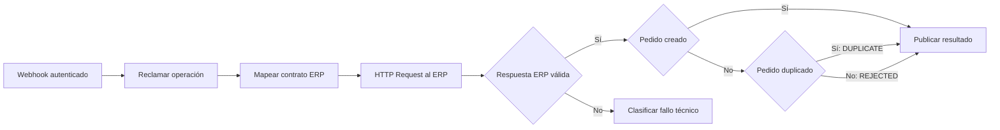
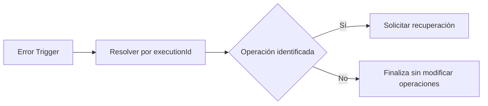

# Workflows n8n

Los archivos en `workflows/` son la fuente importable. Los nombres/IDs de credenciales son identificadores genéricos, no contienen sus valores. La inicialización genera credenciales locales desde `.env` sin exportarlas al repositorio.

## Workflow principal

El mapeo convierte `clientOrderId/items/sku/quantity` en `externalOrderId/lines/productCode/units`. Conserva operación y token; el ERP verifica que coincida con el pedido admitido. `finalize` acepta un recibo, nunca un estado arbitrario.

## Workflow de errores

Los errores sin correlación no modifican otras operaciones. El worker recupera las concesiones vencidas aunque el handler falle. Los registros de ejecución de n8n y los eventos del dominio permiten seguir el intento.

## Restricciones verificadas

La versión probada es **n8n 2.45.6**, mediante webhook de producción real. El flujo normal devuelve acuse inmediato y los resultados se consultan por polling. [Webhook oficial](https://docs.n8n.io/integrations/builtin/core-nodes/n8n-nodes-base.webhook/).

La documentación de Error Trigger señala que se prueba mediante una ejecución automática y que el handler no necesita publicarse. En esta versión instalada, un handler sin publicar fue rechazado con “not active and cannot be executed”; por eso la inicialización **publica ambos workflows**. La prueba `test:recovery` verifica su ejecución efectiva y no asume que el import haya sido suficiente. [Error Trigger oficial](https://docs.n8n.io/integrations/builtin/core-nodes/n8n-nodes-base.errortrigger/).

La publicación por Server CLI necesita reiniciar n8n si estaba corriendo. La inicialización ocurre antes de iniciar el servicio; las reimportaciones deliberadas deben detenerlo primero. [CLI oficial](https://docs.n8n.io/hosting/cli-commands/).

HTTP Request devuelve código/cabeceras para clasificar respuestas. Su timeout no reemplaza un deadline de operación; el dominio aplica el presupuesto y los tokens. [HTTP Request oficial](https://docs.n8n.io/integrations/builtin/core-nodes/n8n-nodes-base.httprequest/).

Estos diagramas describen los JSON reales; no son capturas del editor. Una captura adicional del canvas puede incorporarse después de configurar el propietario local de n8n. No se publica el editor como parte de la demo.
